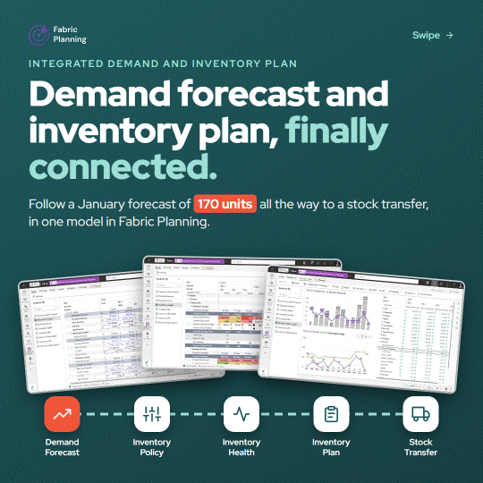
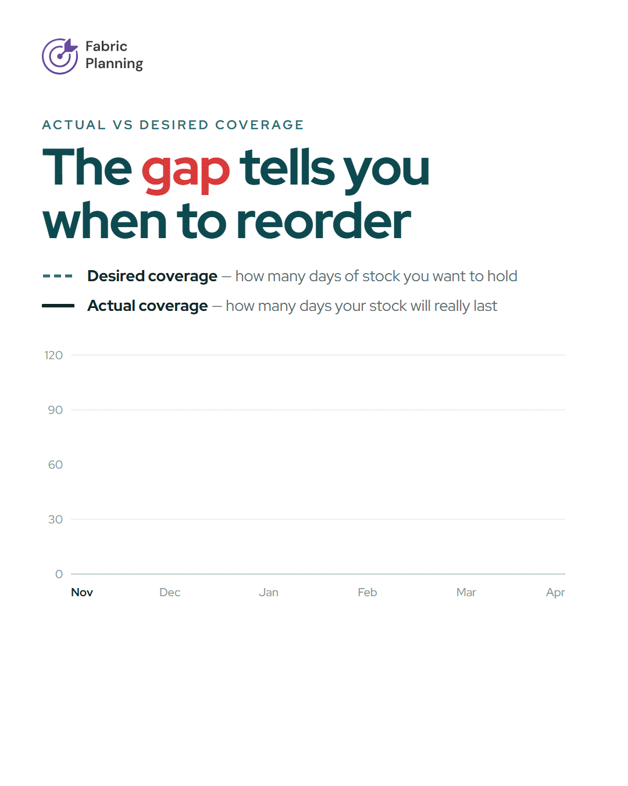

# Juliekiruba J

**GTM Engineer · B2B Growth & Marketing Operations · AI-Powered Campaigns**

I'm a B2B SaaS product marketer who understands the technology and builds the systems that make campaigns work.

At [Lumel](https://lumel.com) I run product marketing for Microsoft Fabric Planning / Lumel EPM and the Inforiver Power BI visuals: 3-4 webinars a month, Pardot email, LinkedIn and Reddit, paid search and social, SEO, and the reporting that ties it together. Over the past year I've replaced a lot of that manual work with automation: AI agents, API pipelines and code-generated creative. Before marketing I was a Power BI developer and data analyst, so I read the data critically and build the tool when there isn't one.

📄 **[Resume (PDF)](resume/Juliekiruba-J-Resume.pdf)** · 💼 [LinkedIn](https://www.linkedin.com/in/juliekiruba-j/) · ✉️ juliekirubaj@gmail.com

---

## ⭐ Featured: Marketing Agent Team

**[JuliekirubaJ/marketing-agent-team](https://github.com/JuliekirubaJ/marketing-agent-team)** is a complete B2B marketing team that runs inside Claude Code, released (MIT license) as a brand-neutral version of the system I run at work.

  

- **36 specialist agents in 11 categories and 44 playbook skills**, coordinated by a `/marketing` orchestrator
- **Installs as a Claude Code plugin:** `/plugin marketplace add JuliekirubaJ/marketing-agent-team`
- **Scheduled automations:** weekly task review, follower tracking, monthly SEO report, weekly ranking + AEO report
- **Pipelines:** SEO reporting (GSC + GA4 APIs, own crawler), task tracker, creative rendering, video production, docs conversion
- **Guardrails:** every agent grounds in one `brand/` folder of approved facts, and nothing ships without approval

## Recent work

  
  

Webinar carousel and animated chart explainer, both generated from code (<a href="case-studies/06-creative-automation.md">how</a>). Chart Shorts: <a href="assets/pie-chart-short.mp4">pie</a> · <a href="assets/waterfall-short.mp4">waterfall</a> (<a href="case-studies/08-ai-video-production.md">how</a>).

## What I build

| # | Project | What it does | Stack |
|---|---|---|---|
| 1 | [AI Marketing Operating System](case-studies/01-ai-marketing-os.md) | 38 specialist AI agents, a shared fact base, a daily desk run and an approval queue for a product marketing team | Claude Code, MCP, PowerShell, Gmail |
| 2 | [SEO + AI-Search (AEO) Reporting Pipeline](case-studies/02-seo-aeo-pipeline.md) | Scheduled Search Console + GA4 API pulls, own crawler, AI-visibility checks, generated workbooks for 3 sites | GSC API, GA4 Data API, OAuth PKCE, PowerShell, Excel |
| 3 | [Email Deliverability Investigation](case-studies/03-email-deliverability.md) | Found why open rates halved across two brands, and changed how new lists get added | Pardot, Excel |
| 4 | [Reddit Paid Experiment](case-studies/04-reddit-paid-experiment.md) | Subreddit-targeted ads for a webinar, tracked daily, with a test readout | Reddit Ads, CSV tracking |
| 5 | [Webinar Operations Pipeline](case-studies/05-webinar-ops.md) | Promotion timeline, task generation, Zoom data consolidation, replay and companion pages | Zoom exports, PowerShell, AI agents |
| 6 | [Code-Generated Creative](case-studies/06-creative-automation.md) | HTML creatives rendered to PNG, PDF and animated GIF; JSON → 74-post branded LinkedIn series | HTML/CSS/JS, headless Edge, PowerShell |
| 7 | [Lead Segmentation & Enrichment](case-studies/07-lead-segmentation.md) | Job-title clustering into personas and an enrichment spec for blank CRM fields | Salesforce exports, Excel |
| 8 | [AI-Assisted Video Production](case-studies/08-ai-video-production.md) | AI picks webinar clips from the transcript; scripts cut vertical Shorts; weekly chart Shorts chosen from Search Console data | Claude Code, PowerShell, PowerPoint automation |
| 9 | [Marketing Ops Automation](case-studies/09-marketing-ops-automation.md) | 726-task process catalogue, scripted task tracker with backups, auto-generated webinar task sets, Monday review | Claude Code, PowerShell, Excel automation |
| 10 | [LinkedIn Growth & Social Listening](case-studies/10-social-intelligence.md) | Post analysis on two company pages, an approval-gated growth agent, follower tracking, Reddit voice-of-customer | LinkedIn analytics, Claude Code, Reddit |

### Working demos in this repo

- **[UTM builder + GA4 attribution walkthrough](demos/utm-attribution/)**: a single-page HTML/JS UTM builder with naming rules, plus how the tagged link shows up as a GA4 key event.
- **[AEO visibility tracker](demos/aeo-tracker/)**: a small PowerShell script that checks a site's llms.txt, AI-crawler rules and page answer-readiness, with a prompt log template for tracking brand mentions in AI answers.

---

## Toolkit

Only tools I have used in real work. Things I'm still learning are listed separately in the [learning log](LEARNING.md).

- **Marketing automation & CRM:** Salesforce Account Engagement (Pardot), Salesforce, HubSpot, Zoom Webinars
- **Paid media:** Google Search Ads, LinkedIn Ads, Reddit Ads
- **Analytics & SEO:** GA4 (incl. Data API), Google Search Console (incl. API), Clicky, Ahrefs, PageSpeed Insights, Power BI, Tableau
- **AI & automation:** Claude Code (multi-agent systems, skills, MCP connectors, scheduled agents), OpenAI LLMs, Power Automate, Power Apps
- **Code & data:** PowerShell, SQL, Python, HTML/CSS/JavaScript, JSON, Git, Microsoft Fabric
- **Web:** WordPress (Yoast), landing pages, JSON-LD schema, llms.txt

## Background

- **Lumel** · Product Marketing Analyst · Sep 2024 - present
- **Finsight Analytics** · Project Manager / Data Analyst · 2023 - 2024: AI invoice processing, Power Automate and Power BI client automation, BI trainer
- **Larsen & Toubro** · Power BI Developer Intern · 2023
- **ELGI Equipments** · Business Intelligence Intern · 2022
- **UT Austin (McCombs)** · PGP, Data Science & Business Analytics · 2024 - 2025

---

Numbers in the case studies are rounded or left out where they belong to my employer. Creatives shown were published publicly. The marketing-agent-team repo is brand-neutral and contains no company data.
