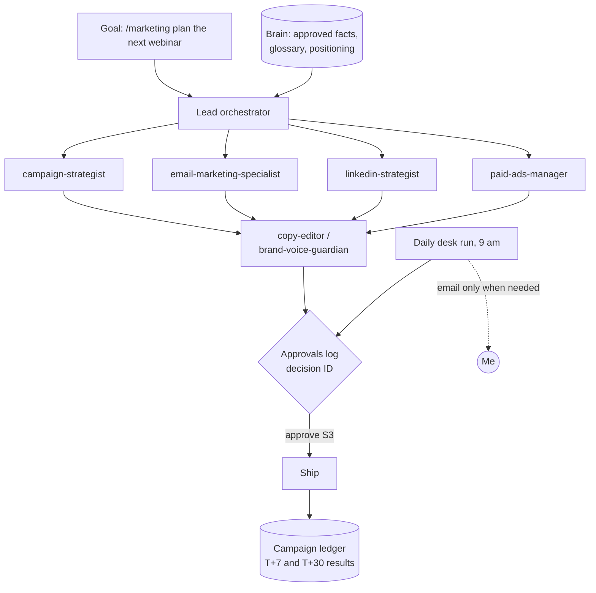

# AI Marketing Operating System

**Role:** designer and builder · **When:** 2026 · **Stack:** Claude Code, custom agents and skills, MCP connectors, PowerShell, Gmail connector

## The problem
One product marketer covering webinars, email, LinkedIn, Reddit, paid, SEO, partner marketing and reporting for two product lines. Generic AI tools helped with drafts, but they got product facts wrong, ignored approved terminology and had no memory of what had already shipped.

## What I built
- **38 specialist agents in 11 teams**: Strategy, Content, Social, SEO, Ads & Growth, Webinars & Events, Customers, Sales & Partners, PR, Analytics and Ops, plus a lead orchestrator (`/marketing`) that picks the right specialists for a goal.
- **A shared "brain"**: one folder of approved product facts, a canonical glossary, a ranking of which source wins when sources disagree, approved taglines and competitive positioning. Every agent reads it before writing, so claims stay consistent.
- **44 playbook skills** for repeatable work: webinar promotion timelines, battlecards, UTM building, nurture design, deliverability checks, A/B test design, llms.txt, schema markup and more.
- **A daily desk run** (weekdays, 9 am) that checks what's due, slipping or waiting, writes short pointers per team, and emails me an HTML summary with decision IDs only when a human call is needed.
- **Approval gating**: every decision gets an ID in an approvals log, and nothing that writes to calendars or trackers runs until I reply `approve S3`. A campaign ledger records each activity with its T+7 and T+30 result.

## How it works

## Use it yourself
A brand-neutral version is public: **[JuliekirubaJ/marketing-agent-team](https://github.com/JuliekirubaJ/marketing-agent-team)**. It has 36 agents in 11 categories, 44 playbook skills, the `/marketing`, `/seo` and `/tasks` commands, installs as a Claude Code plugin, and includes scheduled automations and the PowerShell pipelines for SEO reporting, task tracking, creative rendering and video. Fill in `brand/` with your company's facts and it works for any B2B team.

## Outcome
- Webinar email sequences, LinkedIn posts, battlecards and campaign plans start from approved facts rather than a blank page.
- Product claims are checked against one source of truth before they go out.
- The weekly task review, SEO reporting and webinar data consolidation run on a schedule instead of from memory.

## What I learned
Agents are only as good as their context. Most of the effort went into the fact base and the approval rules, not the prompts.
