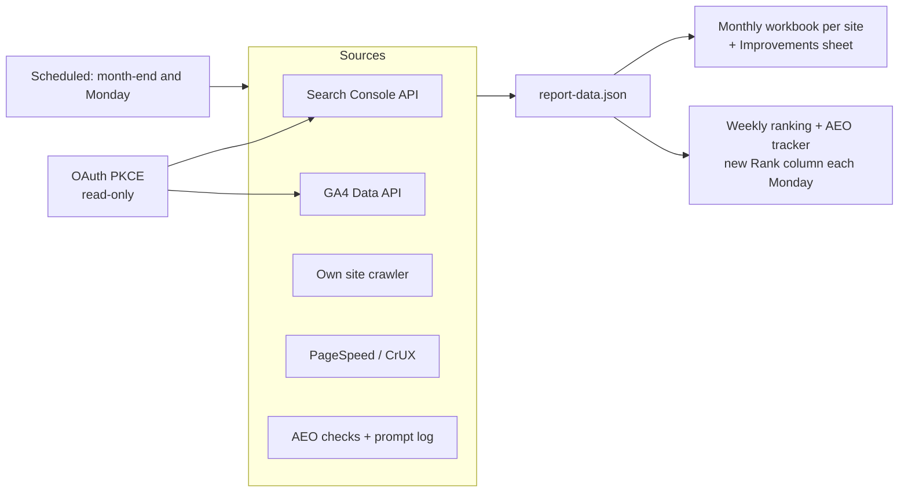

# SEO + AI-Search (AEO) Reporting Pipeline

**Role:** builder and owner · **When:** Sep-Nov 2026 · **Stack:** Google Search Console API, GA4 Data API, OAuth 2.0 (loopback + PKCE), PowerShell, curl, Excel automation, scheduled tasks

## The problem
Monthly SEO reporting for three websites (corporate site, community site, product site) meant exporting from GA4, Search Console, a web analytics tool, Ahrefs, PageSpeed and a paid crawler, then pasting everything into a workbook. It took days, and nobody tracked how the brands showed up in AI answers.

## What I built
1. **Sign-in and data pulls:** a read-only OAuth (PKCE) sign-in to Google, then scripted pulls of Search Console (queries, pages, query × page, devices, countries, sitemaps) and GA4 (channels, landing pages, AI-assistant traffic) for each site.
2. **A site crawler** that replaced the paid crawler licence: homepage + sitemap + internal links, status codes, redirects, titles, meta descriptions, H1s, canonicals and insecure resources, written to the same columns the old export had.
3. **AEO checks:** a weekly test of llms.txt, AI-crawler rules in robots.txt and answer-readiness of target pages (JSON-LD types, one H1, meta description, question-style headings), plus a tracked prompt list for brand mentions in AI answers.
4. **Generated workbooks:** a monthly report per site with an Improvements page, and one weekly ranking + AEO tracker that adds a new "Rank <date>" column each Monday from Search Console average position.
5. **Scheduling:** month-end and Monday runs; manual inputs cut down to a few backlink rows.

## Outcome
- A multi-day manual audit became a scheduled run with a short manual checklist.
- Keyword tracking moved from tool spot-checks to 90 days of Search Console data.
- AI-referral traffic (ChatGPT and other assistants) is now a reported metric, not a guess.

## How it works

The full pipeline, playbook and setup guide are public in [marketing-agent-team/pipelines/seo-reporting](https://github.com/JuliekirubaJ/marketing-agent-team/tree/main/pipelines/seo-reporting).

## Try it
A cut-down version of the AEO check is in [`demos/aeo-tracker`](../demos/aeo-tracker/).
