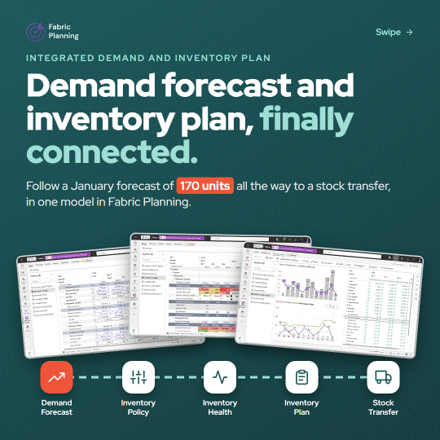
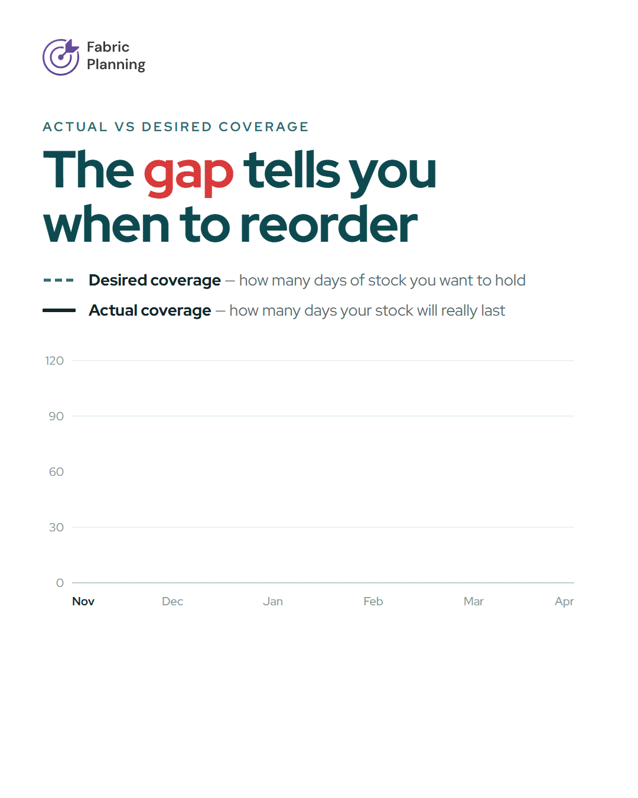

# Code-Generated Creative

**Role:** builder · **When:** Oct-Nov 2026 · **Stack:** HTML/CSS/JavaScript, JSON, headless Microsoft Edge, PowerShell

  
  

Left: an 8-slide webinar carousel built from HTML. Right: an animated chart explainer rendered frame by frame. Both published on LinkedIn.

## The problem
Webinars and weekly social series need a steady flow of on-brand carousels, banners and animated explainers. Design capacity was the bottleneck, and every copy change meant another round of edits.

## What I built
- **Creative as code:** each creative is an HTML/CSS page built to the brand spec. A render script turns it into PNG (1x and 2x) and PDF through headless Edge, so copy changes take minutes.
- **A series generator:** a weekly "100 Charts Explained" LinkedIn series needed 74 posts in one style. I wrote a design spec and a JSON brief per chart (what it shows, how to build it, which features to use), and one command builds a single post or the whole series, using real product chart images.
- **Animated GIFs without a design tool:** the page draws each animation frame on request, headless Edge screenshots every frame, and a script stitches them into a looping GIF with per-frame timing.
- **Editable handoff:** per-slide SVG export with live text, so a designer can still open a creative in Illustrator.

## Why it matters
Creative stays on brand, can be regenerated in minutes, and ships without waiting for design capacity. For video, see [AI-assisted video production](08-ai-video-production.md).

## Reusable version
`pipelines/creative-rendering` in the [marketing-agent-team](https://github.com/JuliekirubaJ/marketing-agent-team) repo.
