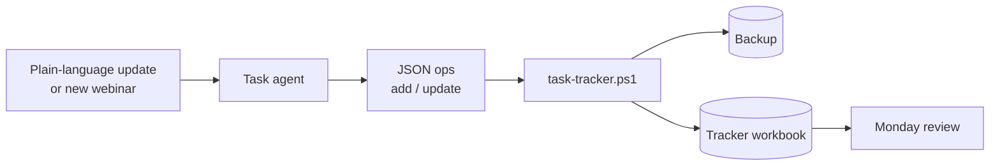

# Marketing Ops: Task Tracker and Process Catalogue

**Role:** builder and owner · **When:** Oct-Nov 2026 · **Stack:** Claude Code agent, PowerShell, Excel automation (COM), JSON

## The problem
The team's task tracker was a shared Excel workbook. Webinar tasks were re-typed every month, duplicates crept in, status lived in people's heads, and nobody could say quickly what was overdue.

## What I built
- **A process catalogue:** every recurring marketing task written down, 726 tasks in 15 categories, grouped into 65 repeatable processes. This made it possible to automate the tracker instead of only cleaning it.
- **A scripted tracker interface:** a PowerShell helper that only edits the workbook through defined operations (`add`, `update`) passed as JSON. It backs up the file before every write, never overwrites notes (it appends a dated history line) and checks for duplicates before adding.
- **A task agent on top:** plain-language updates like "mark the invite email as done" or "move the replay page to next week" become those operations.
- **Webinar task sets:** announcing a new webinar generates its full task list (promotion, email, creatives, video, replay, report) with owners and due dates from a standard template.
- **A Monday review:** a scheduled run lists overdue items, this week, next week, blocked items, backlog, webinar actions and decisions needed.

## How it works

## Outcome
- A new webinar's task list takes seconds instead of a manual copy and edit.
- The weekly review is generated, not assembled.
- Changes happen only after approval, and every write leaves a backup and a history line.

## Reusable version
See `pipelines/task-tracker` in the [marketing-agent-team](https://github.com/JuliekirubaJ/marketing-agent-team) repo.
